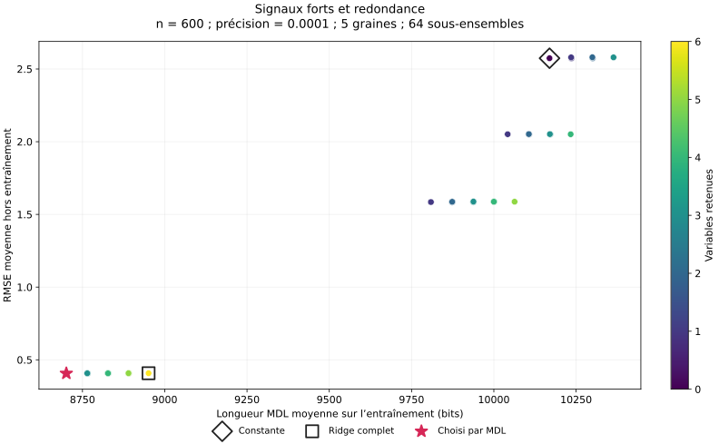
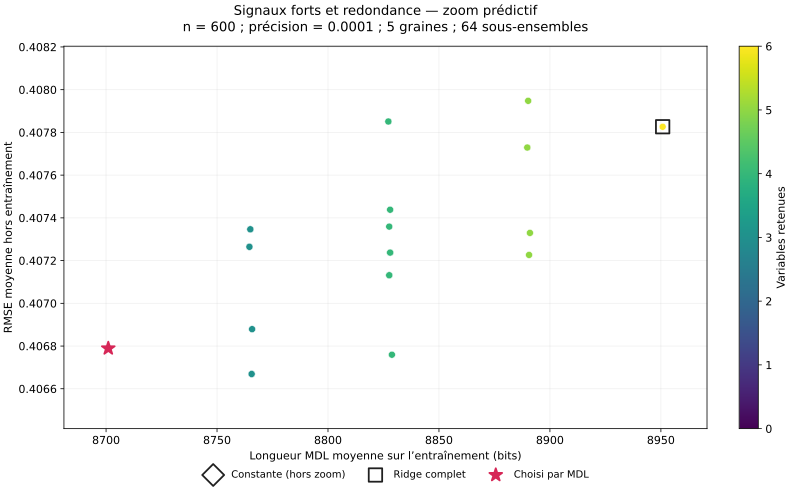

# MDL and held-out error for every feature subset

## Fixed comparison

This diagnostic completes the original independent synthetic controls: 600 training rows,
300 held-out rows, target precision 0.0001, Ridge alpha 1, seeds 0 through 4. The same generator
and split reproduce the original 600/300 experiment, rather than the larger sensitivity pool.
The [versioned configuration](../experiments/mdl-frontier-v1.json) is fixed before this run.

For each of three scenarios and each seed, fit all 64 subsets on training rows only.
Choose the MDL minimum before measuring held-out errors, then replay every candidate's
serialized binary64 parameters on the same held-out block. Standardization is derived from
training X only. The empty subset predicts the training target mean.

This yields 960 candidate evaluations. It does not introduce another selector, tune Ridge,
change the financial protocol, or evaluate the reserved 2024–2025 SPY test.

## Reading the figures

- Horizontal axis: **mean total training code length**, in bits, over the five seeds.
  It includes the subset identifier, model parameters and conditional target code.
- Vertical axis: **mean held-out RMSE**, measured on continuous targets.
- One point: one named subset, evaluated on every seed. Color: number of selected features.
- Highlighted markers: constant model, full Ridge, and subsets selected by training MDL on
  at least one seed. `selection_count` records how often each subset is selected.
- The HTML hover shows subset names, RMSE standard deviation and selection count.
  Standard deviations across five seeds are not confidence intervals.

Every scenario has a complete view and an explicitly labeled predictive zoom. The zoom frames
points with error at most 110% of full Ridge's mean RMSE, with 20% error-span padding
(at least 0.0005 times full Ridge RMSE) and 8% bit-span padding (at least one bit).
This enlarges small differences: read the numeric axes rather than interpreting visual
distance as a large relative gain. This is a display rule, not a selection threshold. The complete view
always retains all 64 points, including poor predictors outside the zoom.

Mean points do not represent one fitted model: they aggregate the same named subset over
different generated datasets. MDL selection is performed independently within each seed,
not by minimizing the displayed mean or choosing the lowest held-out RMSE. If selections
vary, several points can carry the MDL marker. Exact duplicate inputs can create overlapping
points; ties are resolved by the selector's declared feature order.

## Reproduction and presentation exports

```powershell
uv sync --locked --dev
uv run financial-mdl mdl-frontier --config experiments/mdl-frontier-v1.json --output artifacts/mdl-frontier-v1
```

Open `artifacts/mdl-frontier-v1/index.html` for the local overview. Each scenario exports
`*-all` and `*-zoom` in self-contained Plotly HTML, JSON, PNG (200 dpi) and editable SVG.
Static exports use Matplotlib's headless canvas and need no browser or graphics server.
`subsets.csv` retains all per-seed results; `summary.csv` contains one row per scenario/subset.
Selection diagnostics retain all model bytes and training costs. `experiment.json` records
the complete configuration, source/runtime provenance and fingerprint before fitting.

The synthetic held-out block is now inspected for all candidates. These are exploratory
diagnostics, not a fresh test set for selecting a new model. Keep any ensuing model changes
separate from claims about the reserved financial final test.

## Observed results

The complete 960-evaluation run used clean source commit
`89d46dc4b5f01ab6440e8c1841ca24f208963070` and experiment fingerprint
`7b1376c76e639dbb53d174bc3bd52af23a97a09733451d42435c0c777701686b`.
The [192-row summary](results/mdl-frontier-v1-summary.csv) and six SVG figures are versioned;
per-seed records, diagnostics, interactive HTML and PNG files remain in the local output folder.
Results for full Ridge and the selected model reproduce the original synthetic controls.

| Scenario | MDL feature count | Mean full code, bits | Mean MDL code, bits | Full Ridge mean RMSE | Selected mean RMSE |
| --- | ---: | ---: | ---: | ---: | ---: |
| Strong signals + redundancy | 2 | 8,950.8 | 8,701.0 | 0.407826 | 0.406789 |
| Noise only | 0 | 8,950.8 | 8,569.8 | 0.407890 | 0.406934 |
| Weak signal | 0 | 8,950.8 | 8,576.6 | 0.407888 | 0.407029 |

MDL selects the same named subset in all five seeds of each scenario. Strong-signal models
retain `signal_a` and `signal_b`; the other scenarios select the constant. These are code-based
decisions, not the minima of the displayed held-out errors.



The complete view shows the substantial predictive error from omitting a strong signal.
The narrow low-error cluster contains models retaining the informative variables, with
different amounts of redundant/noise input. Their errors are close but their code lengths differ.



In the zoom, the selected two-feature model has a shorter code than full Ridge and a slightly
lower mean held-out RMSE. A three-feature model including `noise_1` obtains an even smaller
mean RMSE, 0.406669, than the selected model's 0.406789. In noise-only data, the smallest
displayed mean RMSE, 0.406643, belongs to `signal_b, noise_1`, even though neither predicts
the target in the generator. These small differences illustrate why inspection of held-out
scores is diagnostic and must not silently replace the training selection rule. No new
candidate or coding configuration was selected from these scores.

For the other scenarios, see the [noise-only complete view](figures/mdl-frontier-v1/noise_only-all.svg),
[noise-only zoom](figures/mdl-frontier-v1/noise_only-zoom.svg),
[weak-signal complete view](figures/mdl-frontier-v1/weak_signal-all.svg) and
[weak-signal zoom](figures/mdl-frontier-v1/weak_signal-zoom.svg).
The five-seed mean improvements over full Ridge are small and do not establish statistical
superiority. The larger sensitivity experiment, rather than this single 600-row configuration,
explains when the weak signal can repay its representation cost.
