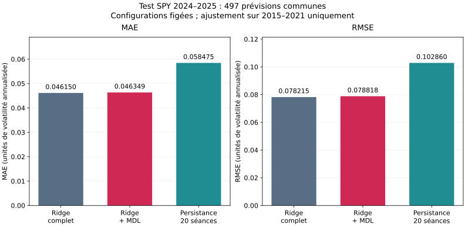
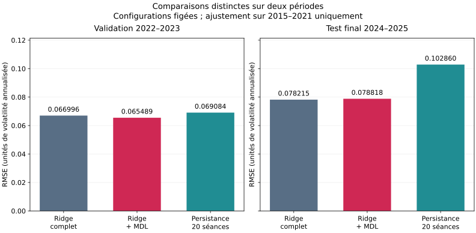

# Frozen SPY final evaluation

## Plan fixed before test scores

The [candidate plan](../experiments/spy-final-test-v1.json) is committed before requesting
the reserved 2024–2025 test scores. It binds the existing daily SPY snapshot and immutable
`spy-volatility` v1 benchmark; it does not change the protocol or feature universe.

- Candidates: full Ridge, Ridge with the original MDL selector, and 20-session persistence.
- Ridge alpha 1, intercept enabled, training-only standardization, seed 42, one-step strategy.
- MDL code `ridge_binary64_geometric_v1`, target precision 0.0001, original exhaustive search.
- Target: annualized RMS volatility over the next five observed sessions, without demeaning.
- All fitted components use the original 2015–2021 training partition only. Validation is
  not added to training. The same deterministic training search must reproduce the original
  three MDL features and 20,045 selected training bits versus 20,157 full training bits.
- Test labels must end by 2025-12-31. Expected common test origins: 497, from 2024-01-02
  through 2025-12-23. Eligibility remains complete cases across all five protocol features.
- Forecasts are issued after each session close. Features can use prices already observed
  within the test period; fitted parameters never use test targets.
- Primary metric RMSE, secondary MAE. Report all three candidates on identical test rows.
  Check the existing exploratory `RMSE_mdl / RMSE_full <= 1.02` rule. It is a descriptive
  performance tolerance, not a statistically established non-inferiority test.
- No model, subset, precision or hyperparameter will be adjusted from the test scores.
  Validation and test results remain separate comparisons.

No new scientific implementation is required: the existing explicit `--phase test` path
performs the evaluation and records provenance. Runs and their comparison use local MLflow
with the `test` phase; candidate outputs use fresh directories.

## Reproduction

Use the original frozen dataset and choose new output directories for an independently
audited replay. Replaying a frozen evaluation does not create another untouched test set.

```powershell
uv sync --locked --dev --extra tracking
uv run --no-sync financial-mdl run --data data/spy.parquet --protocol protocols/spy-volatility-v1.json --estimator ridge --selector identity --strategy one-step --seed 42 --phase test --output artifacts/spy-final-test-v1/full --tracking
uv run --no-sync financial-mdl run --data data/spy.parquet --protocol protocols/spy-volatility-v1.json --estimator ridge --selector mdl --mdl-target-precision 0.0001 --strategy one-step --seed 42 --phase test --output artifacts/spy-final-test-v1/mdl --tracking
uv run --no-sync financial-mdl run --data data/spy.parquet --protocol protocols/spy-volatility-v1.json --estimator persistence-20 --selector identity --strategy one-step --seed 42 --phase test --output artifacts/spy-final-test-v1/persistence-20 --tracking
uv run --no-sync financial-mdl compare artifacts/spy-final-test-v1/full artifacts/spy-final-test-v1/mdl artifacts/spy-final-test-v1/persistence-20 --output artifacts/spy-final-test-v1/comparison --tracking
uv run --no-sync python experiments/report_spy_final_test.py --output artifacts/spy-final-test-v1/report
```

The reporting script reads saved validation/test artifacts and checks them before exporting
tables and PNG/SVG/Plotly figures. It does not fit or select any models. Use a fresh report
directory when replaying it. No raw data download or protocol rewrite is part of this study.

## Verification and interpretation

Verify common protocol, dataset and test evaluation fingerprints; identical observations
and dates; unchanged training split, candidate parameters and MDL diagnostics relative to
validation; and matching MAE/RMSE recomputed from exported predictions. The earlier evaluation
fingerprint identifies validation rows and is expected to differ from the final test fingerprint.

Training code lengths remain training quantities; no test code search is performed. A result
within +2% supports only the declared tolerance on this period. A result outside it means the
selected representation fails that tolerance on this period, even if it remains shorter.
Both outcomes must be reported. Overlapping labels and serial dependence remain, so the
497 forecasts do not represent 497 independent observations. No significance claim is planned.

## Observed final results

The candidates and rules were frozen in commit
`ebae61c0b09cd0e94776f9fcb17669fb1643ea6b` before the test scores were requested.
All three candidate runs used that clean commit. Their common test evaluation fingerprint is
`8e0f50d3e01b8223ec55f12abca8ab5cd2732f62f0ab32af0f5b1af9d231d81d`.

| Candidate | Features consumed | Test MAE | Test RMSE |
| --- | ---: | ---: | ---: |
| Full Ridge | 5 | 0.0461498800 | 0.0782151370 |
| Ridge + MDL | 3 | 0.0463493197 | 0.0788180606 |
| Persistence 20 sessions | 1 | 0.0584749592 | 0.1028600534 |

Persistence consumes only `realized_volatility_20`, while all five protocol features continue
to determine the same eligible origins. The MDL model retains exactly `log_return_5`,
`realized_volatility_5` and `realized_volatility_20`.

Relative to full Ridge, MDL's test RMSE is **0.77085% higher** and its MAE is **0.43216% higher**.
The RMSE ratio **1.00770853** is below the declared **1.02** limit. Thus the selected model
meets the exploratory performance tolerance on this final period with **40% fewer features**.
Its RMSE is also **23.37% lower** than persistence 20 on the same test origins.

The validation improvement does not repeat as a test improvement:

| Candidate | Validation RMSE, 2022–2023 | Final test RMSE, 2024–2025 |
| --- | ---: | ---: |
| Full Ridge | 0.066996 | 0.078215 |
| Ridge + MDL | 0.065489 | 0.078818 |
| Persistence 20 sessions | 0.069084 | 0.102860 |

Each column is a separate, aligned comparison. No metric is pooled across phases, and the
differences between periods are not a controlled estimate of a model change. The signed
MDL-versus-full change is **-2.25% on validation** and **+0.77% on test**.





The [full-period forecast figure](figures/spy-final-test-v1/test-forecasts.svg) shows observed
future volatility and all three forecasts at their prediction origins. It is diagnostic only;
no dates or candidates were excluded after inspecting errors.

## Audit trail and supported conclusion

The [versioned summary](results/spy-final-test-v1-summary.csv) retains both phases explicitly.
The [verification record](results/spy-final-test-v1-verification.json) records the shared test
dates, fingerprints, prediction-file hashes, metric recomputation and four finished local
MLflow runs: the three candidates and their test-only comparison.

The original validation and final test runs have identical candidate settings, training
partitions and runtime package versions. MDL's entire training diagnostic, including all
32 subset scores and serialized parameter words, is unchanged. The total training code
remains 20,045 bits versus 20,157 for full Ridge: **112 bits saved**, or 0.56%. These are
training code costs, not measured test compression gains. No fitted component used validation
or test targets, and no candidate was retuned after these final scores.

The supported conclusion is: **this code selects a smaller Ridge model whose test error
remains within the predeclared exploratory tolerance, while full Ridge has slightly better
test MAE/RMSE**. The experiment supports simplification with a small predictive trade-off;
it does not show a general predictive advantage or establish statistical non-inferiority.
The final test has now been inspected. Subsequent changes informed by these scores need a
new evaluation design rather than treating this period as untouched again.
